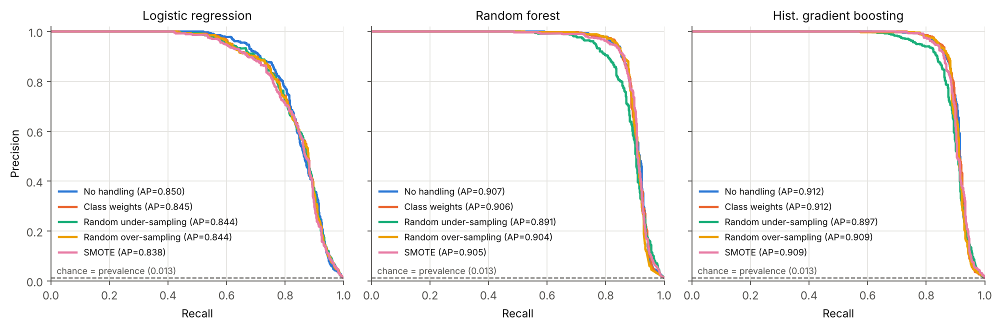
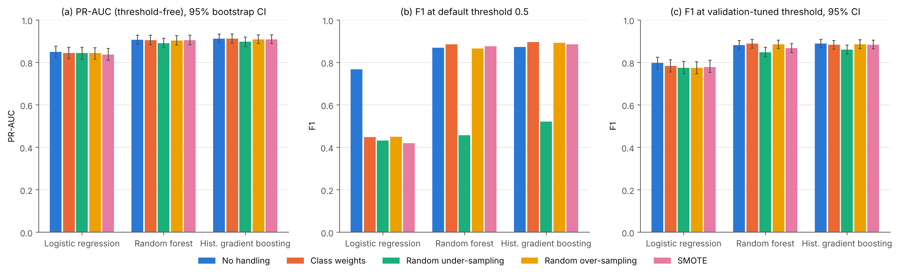
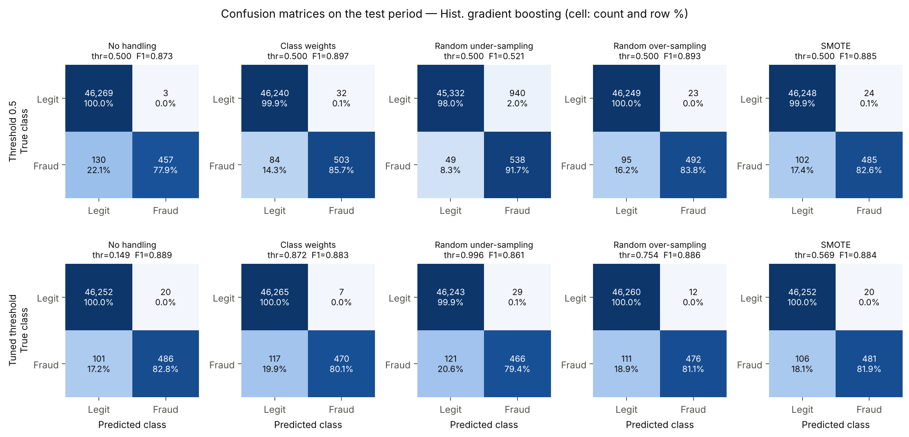
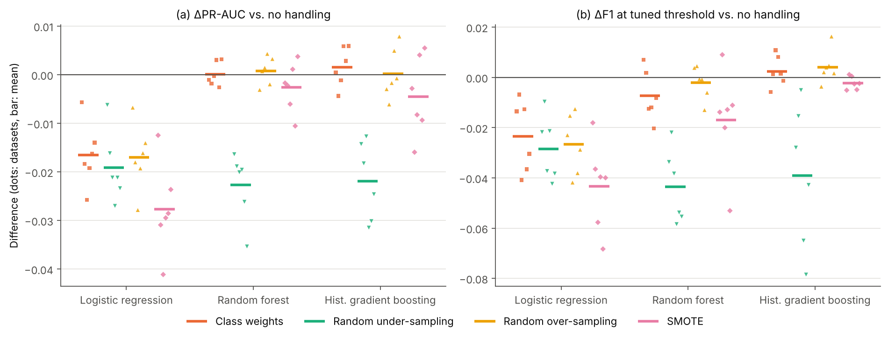

# Fraud Detection on Highly Imbalanced Transaction Data

A self-contained research mini-project. It studies how to detect fraudulent
card transactions when fraud is only **1%** of the data, and whether explicit
class-imbalance handling (class weights, random under-/over-sampling, SMOTE)
actually helps. Everything here comes from one command: the synthetic
dataset, the behavioural features, 15 model/strategy configurations, a
resampling-ratio ablation, a 6-dataset robustness study, and all figures
and metric tables. The write-up is in [`paper/paper.md`](paper/paper.md).

```bash
pip install -r requirements.txt
python -m src.pipeline          # full run (~22 min on 4 cores): regenerates data/, results/
python -m pytest -q             # 12 unit tests (incl. a no-look-ahead check)
```

## Key results

Test period: days 72–90, 46,859 transactions, 587 frauds (1.25%). Full
tables are in [`results/summary.md`](results/summary.md).

| Model | Strategy | PR-AUC [95% CI] | ROC-AUC | F1 @ 0.5 | F1 @ tuned τ* | P / R @ τ* |
|---|---|---|---|---|---|---|
| Logistic regression | none | 0.850 [0.823, 0.877] | 0.978 | 0.768 | 0.797 | 0.903 / 0.714 |
| Logistic regression | SMOTE | 0.838 [0.811, 0.865] | 0.979 | 0.419 | 0.779 | 0.892 / 0.692 |
| Random forest | none | 0.907 [0.885, 0.928] | 0.976 | 0.870 | 0.882 | 0.977 / 0.804 |
| Random forest | class weights | 0.906 [0.884, 0.928] | 0.976 | 0.886 | 0.889 | 0.970 / 0.821 |
| **Hist. gradient boosting** | **none** | **0.912 [0.890, 0.933]** | 0.982 | 0.873 | **0.889** | 0.960 / 0.828 |
| Hist. gradient boosting | class weights | 0.912 [0.892, 0.933] | 0.978 | **0.897** | 0.883 | 0.985 / 0.801 |
| Hist. gradient boosting | random under | 0.897 [0.875, 0.920] | 0.981 | 0.521 | 0.861 | 0.941 / 0.794 |
| Hist. gradient boosting | SMOTE | 0.909 [0.889, 0.930] | 0.983 | 0.885 | 0.884 | 0.960 / 0.819 |
| *always "legitimate"* | — | 0.0125 (= prevalence) | 0.5 | 0 | — | accuracy **98.75%** |

1. **Accuracy is useless here.** Predicting "legitimate" for everything
   scores 98.75%, and all trained models fall between 96.9% and 99.75%.
2. **No imbalance strategy significantly improves PR-AUC for any model.**
   Paired bootstrap ΔPR-AUC CIs all include 0 or are negative. Random
   under-sampling (−0.014 to −0.016 for the trees) and *every* correction
   applied to logistic regression (−0.006 to −0.013) are significantly
   worse. On 5 more independently generated datasets, under-sampling and
   all logistic-regression corrections lose on **6/6** datasets. Class
   weights and over-sampling are neutral for the trees (mean ΔPR-AUC
   ≤ +0.002).
3. **Imbalance handling mostly moves the threshold.** At 0.5, F1 swings
   by up to 0.43 between strategies for the same model. After tuning the
   threshold on the validation period, the spread shrinks to a few
   hundredths, and the corrected logistic models choose τ* ≈ 0.95–0.96,
   which undoes the reweighting.
4. **Resampling distorts calibration.** The logistic-regression Brier
   score rises about 7× (0.0040 → 0.027–0.030), and under-sampling
   over-predicts fraud by about 10× for every model.
5. **Errors come from the fraud type, not the strategy.** Card testing is
   caught 97–99.6% of the time and CNP sprees 72–80%. Stolen cards are
   caught 51–64%, and `mimic` fraud, which copies the customer's habits,
   about 0%, under every strategy.

| PR curves | Effect of imbalance handling |
|---|---|
|  |  |
| **Confusion matrices (HGB)** | **Robustness across 6 datasets** |
|  |  |

Other figures: ROC curves with a log-FPR axis, operating points
(0.5 → τ*), the resampling-ratio ablation, calibration, recall by fraud
scenario, permutation importance and a dataset overview. All are in
[`results/figures/`](results/figures).

## Repository layout

```
├── src/
│   ├── config.py           # seed, dataset size, split fractions, bootstrap size
│   ├── data_generation.py  # synthetic transaction + fraud generator (documented model)
│   ├── features.py         # causal behavioural feature engineering (29 features)
│   ├── imbalance.py        # class weights, RUS, ROS, SMOTE (imblearn or manual fallback)
│   ├── models.py           # logistic regression, random forest, hist. gradient boosting
│   ├── evaluate.py         # PR-AUC, ROC-AUC, P/R/F1, MCC, threshold tuning, bootstrap CIs
│   ├── plots.py            # every figure in results/figures/
│   └── pipeline.py         # end-to-end experiment (entry point)
├── tests/test_pipeline.py  # determinism, fraud rate, causality, resampling, metric sanity
├── data/
│   ├── sample_transactions.csv   # 1,000-row sample (the full CSV is regenerated, git-ignored)
│   └── DATA_CARD.md              # how the data are generated
├── results/
│   ├── metrics_all.csv                         # every metric, every configuration
│   ├── metrics_with_vs_without_handling.csv    # headline comparison table
│   ├── confusion_matrices.csv
│   ├── sampling_ratio_ablation.csv
│   ├── recall_by_scenario.csv
│   ├── seed_robustness.csv                     # grid repeated on 6 independent datasets
│   ├── permutation_importance.csv
│   ├── summary.json / summary.md               # dataset stats + formatted tables
│   └── figures/*.png
└── paper/paper.md          # the write-up
```

## Design decisions (and why)

**Synthetic data.** The best-known public fraud dataset (Kaggle/ULB
credit-card) needs a login and contains only PCA components, so it cannot
show *behavioural* feature engineering. Instead, `src/data_generation.py`
simulates 3,000 customers over 90 days. Each customer has a personal
profile: spend level, category mix, activity rate, chronotype, online
propensity, and sometimes a trip. Fraud is injected as *compromise events*
that produce bursts in four styles: CNP spree, card testing, stolen card and
mimic. Events are added until fraud is exactly 1.00% of rows. Legitimate
behaviour is noisy on purpose (night purchases, travel, expensive
electronics), and the `mimic` scenario copies the victim's own habits, so the
task cannot be solved perfectly. Details are in
[`data/DATA_CARD.md`](data/DATA_CARD.md).

**Causal features.** Every behavioural feature (velocity in the last 1 h or
24 h, time since the last transaction, amount z-score against the customer's
own history, first purchase in a category, and so on) uses only the
customer's *earlier* transactions. That is exactly what a real-time scorer
knows at authorisation. A unit test enforces it: deleting all future rows
must leave the features of past rows unchanged. This test caught a real
leak during development: a cold-start fallback had used a dataset-wide mean.

**Chronological split.** Train on days 0–54, validate on days 54–72, test on
days 72–90. A random split would let the model see the future, and it
would also put transactions from the same fraud burst on both sides of the
split.

**Resampling only on training data.** The scaler is fit on the training
period. RUS, ROS and SMOTE are applied *after* scaling, so SMOTE's
k-nearest-neighbour search works in standardised space, and they are applied
*only* to the training set. Validation and test keep the true 1% prevalence.

**Robustness beyond one dataset.** A test-set bootstrap measures noise
for one dataset only. The whole grid is therefore repeated on five more
independently generated datasets (`ROBUSTNESS_SEEDS`), and we report
paired within-dataset differences.

**Two operating points.** Resampling and class weights shift predicted
probabilities upward. A fixed 0.5 threshold therefore mixes up "the
model ranks better" with "the model's threshold moved". We report
(i) threshold-free PR-AUC and ROC-AUC, (ii) metrics at 0.5, and (iii) metrics
at the threshold that maximises F1 on the *validation* period, which is then
frozen and applied to test.

**Metrics for imbalance.** PR-AUC (average precision) is the primary metric,
because its chance level is the prevalence (0.01), while ROC-AUC's is 0.5 and
can look flattering. We also report recall at 1% FPR, MCC, the
fraud-*dollar* recall, the Brier score (calibration), and percentile
bootstrap 95% CIs (1,000 resamples). Differences against the no-handling
baseline use a *paired* bootstrap. Accuracy is reported only to show that it
is useless here: an "always legitimate" classifier gets 99%.

**Fixed hyper-parameters.** Each model uses one reasonable configuration
for every strategy. If we tuned per strategy, the comparison would partly
measure tuning effort instead of imbalance handling.

**imbalanced-learn is optional.** If it is missing, `src/imbalance.py`
switches to NumPy implementations of RUS, ROS and SMOTE, and the tests check
that both paths give the same class counts.

## Reproducibility

* A single seed (`src/config.py`, `SEED = 42`) drives data generation,
  resampling, model training and the bootstrap. `python -m src.pipeline --seed N`
  reruns the whole study on a different synthetic world.
* `python -m src.pipeline --quick` runs a 600-customer smoke test in about
  1 minute and writes to `results_quick/` (git-ignored), so it never
  overwrites the committed results.
* The committed results were produced with Python 3.13, numpy 2.5.3,
  pandas 3.0.5, scikit-learn 1.9.1, imbalanced-learn 0.14.2 and
  matplotlib 3.11.2 on 4 CPU cores.
* **Verified:** the full pipeline was run twice from scratch. The dataset,
  all logistic-regression and gradient-boosting results and the whole
  ablation were bit-identical. Random-forest scores differed only at
  floating-point level because multithreaded tree averaging sums in a
  different order. The largest metric difference was 1.2 × 10⁻⁵, well
  below the 3–4 decimals reported anywhere. Library upgrades may move the
  last decimals.
* Console log of the reference run: `results/run_log.txt`.
