# Does Class-Imbalance Handling Help Fraud Detection? A Controlled Study on Synthetic Transactions with 1% Fraud

*Research mini-project. All code, data generation, results and figures are
reproducible with `python -m src.pipeline` from this repository.*

## Abstract

Fraud detection is a canonical highly imbalanced classification problem,
and practitioners routinely add class weights, under-sampling,
over-sampling or SMOTE "to deal with the imbalance". We test whether these
techniques help in a controlled, reproducible setting. We generate a
realistic synthetic stream of 234,291 card transactions from 3,000
customers over 90 days, of which exactly 1.00% are fraudulent. The fraud
comes from four documented scenarios: card-not-present sprees, card
testing, stolen physical cards, and "mimic" fraud that copies the victim's
habits. From the stream we derive 29 causal behavioural features
(velocity, deviation from the customer's own history, novelty). Three
classifiers (logistic regression, random forest, histogram gradient
boosting) are each trained with five imbalance strategies and evaluated on
a later, held-out time period. We report PR-AUC with paired bootstrap
confidence intervals, metrics at the default and a validation-tuned
threshold, and calibration, and we replicate on five independently
generated datasets. Gradient boosting performs best (PR-AUC 0.912
[0.890, 0.933]; precision 0.960 and recall 0.828 at the tuned threshold),
while a trivial "always legitimate" classifier reaches 98.75% accuracy,
which shows that accuracy is meaningless here. **No imbalance strategy
significantly improves PR-AUC for any model.** Random under-sampling
significantly *reduces* it for every model (−0.006 to −0.016 on the main
dataset, and lower on 6 of 6 replicate datasets), every correction hurts
logistic regression, and most strategies degrade calibration. Class
weights and over-sampling are neutral for tree ensembles (mean ΔPR-AUC
≤ +0.002 across datasets). Imbalance handling mainly shifts the score scale. At a fixed
0.5 threshold it changes F1 by up to 0.43, but this effect almost
disappears once the threshold is tuned on validation data. The levers that
matter are model capacity, behavioural features and an explicit choice of
operating point.

## 1 Introduction

Payment fraud is a textbook *needle-in-a-haystack* problem. Card networks
see billions of authorisations, and only a small fraction of them,
typically well under 1%, are fraudulent. Yet that fraction drives most
losses, chargebacks and customer churn [1, 2]. A fraud classifier has two
masters. Every missed fraud costs money (false negatives), and every
legitimate transaction that is blocked or sent for review costs analyst time
and customer goodwill (false positives). Because legitimate transactions
outnumber fraud about 100:1, even a 1% false-positive rate produces as many
false alarms as there are frauds.

This imbalance has two well-known consequences. First, **standard metrics
mislead**. A model that never predicts fraud is 99% accurate, and ROC-AUC
can look excellent while precision at any useful recall stays poor [3, 4].
Second, **standard learners trained on the raw class distribution tend to
favour the majority class**. This motivated a large literature on
imbalance handling: re-weighting the loss (cost-sensitive learning [5]),
under-sampling the majority class, over-sampling the minority class, and
synthesising minority examples with SMOTE [6] and its variants [7, 19];
see [14] for a survey.

The practical question for an engineer is whether these techniques help,
and on which metric. Recent work argues that, for probabilistic
classifiers, imbalance corrections mostly shift and distort predicted
probabilities rather than improve discrimination [8]. Other studies of
real fraud data report gains from under-sampling, especially for fast
retraining [9, 10]. This project measures the effect directly in a
controlled, fully reproducible setting.

**Contributions.**
1. A documented generator of realistic synthetic card transactions with
   exactly 1.00% fraud, drawn from four fraud scenarios that differ in how
   detectable they are (§3.1), plus 29 *causal* behavioural features with a
   unit test that rules out look-ahead leakage (§3.2).
2. A controlled comparison of 3 classifiers × 5 imbalance strategies
   (none, class weights, random under-sampling, random over-sampling, SMOTE)
   on a chronological train/validation/test split. The evaluation separates
   ranking quality (PR-AUC, ROC-AUC) from threshold effects (precision,
   recall and F1 at 0.5 versus a validation-tuned threshold) and reports
   paired bootstrap confidence intervals (§3.4–§4).
3. An ablation over the post-resampling class ratio, a calibration
   analysis, a per-scenario recall analysis and permutation importances.
   Together these explain *why* imbalance handling helps or fails to help
   (§4–§5).

## 2 Background

### 2.1 Fraud detection

Operational fraud detection systems score each transaction in real time,
using the transaction's attributes together with *behavioural* aggregates
over the card holder's history: transaction velocity, deviation from usual
amounts, unusual merchant types or locations, and time since the last
purchase [1, 11]. Feature engineering of this kind often matters more than
the choice of classifier [11]. Common fraud patterns include
**card-not-present (CNP) fraud**, where stolen card details are used
online; **card testing**, where many tiny charges check whether a stolen
number works before it is cashed out; and **lost or stolen physical
cards**. Fraud arrives in bursts, so transactions from the same compromise
are correlated. Fraudsters also adapt, which makes the problem
non-stationary (concept drift [1]). Labels come from chargebacks and
investigations, so they are delayed and partly noisy.

### 2.2 Learning under class imbalance

Let π = P(y = 1) be the prevalence, here 0.01. Imbalance-handling methods
fall into two families.

* **Algorithm-level (cost-sensitive) methods** keep the data and change the
  loss. With class weights w₁/w₀ = (1 − π)/π, each class contributes
  equally to the empirical risk. Scikit-learn's `"balanced"` rule sets
  w_k = n / (2 n_k) [5, 12].
* **Data-level methods** change the training distribution. *Random
  under-sampling* (RUS) discards majority rows. It is cheap, but it throws
  information away. *Random over-sampling* (ROS) duplicates minority rows,
  which can encourage over-fitting to those exact points. *SMOTE* [6] creates
  synthetic minority points x_new = x_i + u·(x_nn − x_i), u ~ U(0, 1), on
  segments between a minority sample and one of its k nearest minority
  neighbours, which spreads the minority region out.

Re-weighting and resampling to a ratio r both change the class prior the
model effectively sees. For a well-specified probabilistic model this
mostly *shifts* the decision boundary in score space; Elkan [5] gives the
equivalence between a threshold change and a change of class prior.
Probabilities are therefore inflated relative to the true prevalence. If
the decision threshold is tuned afterwards, most of the apparent gain from
imbalance handling at a fixed 0.5 threshold may disappear [8].

### 2.3 Why PR-AUC

ROC curves plot TPR against FPR. Both are normalised *within* a class, so
the ROC curve does not change with prevalence. With 99 negatives per
positive, however, FPR = 1% already produces about one false alarm per
fraud. The ROC region that matters operationally (FPR ≪ 1%) is a sliver of
the plot, and ROC-AUC averages over large FPR ranges nobody would deploy
[3, 4]. The precision–recall curve replaces FPR with precision,
TP/(TP + FP), which depends directly on prevalence: the random-classifier
baseline is precision = π. **PR-AUC**, computed here as average precision
(AP = Σₙ (Rₙ − Rₙ₋₁) Pₙ), therefore has chance level π = 0.01 instead of
0.5, and it rewards good precision at high ranks. Saito and Rehmsmeier
[3] and Davis and Goadrich [4] recommend it for imbalanced problems, and it
is the primary metric here. Threshold-dependent summaries (precision,
recall, F1, MCC [13]) and the confusion matrix are still needed to describe
an actual operating point.

## 3 Methodology

### 3.1 Synthetic dataset

No public fraud dataset is both freely downloadable without
authentication and rich enough for behavioural features. The widely used
ULB/Kaggle card dataset [9] contains only PCA components, and access
requires a login. Following the simulation-based approach of PaySim [18], we therefore
simulate a transaction stream with a documented generative model (`src/data_generation.py`, `data/DATA_CARD.md`).

**Customers.** 3,000 card holders are observed for 90 days. Each has
log-normal spend level and activity rate, a Dirichlet preference over 10
merchant categories (grocery, restaurant, gas/transport, apparel, online
retail, electronics, travel, entertainment, health, gift cards/digital), a
chronotype (preferred hour), an online-shopping propensity and, with
probability 0.15, one 3–10-day trip 200–3,000 km from home.

**Legitimate transactions.** Each customer makes a Poisson number of
purchases. For each purchase the model draws the category from the
customer's mix and the hour from a daytime-centred mixture; 12% of
purchases fall at any hour. The amount is a category median × the
customer's spend level × log-normal noise. The channel (card-present or
online) depends on category and customer. The geolocation distance is a
few km for card-present purchases, a noisier IP distance for online ones,
and the trip distance while travelling. This produces realistic
*legitimate* anomalies: night purchases, expensive one-off purchases and
purchases far from home.

**Fraud.** *Compromise events* hit random customers. Each event emits a
burst in one of four styles (event shares in brackets):
`cnp_spree` (45%): online, risky categories, 2–6× usual amounts, often a
far-away IP; `card_testing` (20%): 3–15 charges under $5 a few minutes
apart, sometimes followed by a cash-out; `stolen_card` (20%): card-present
in another city, about 2× usual amounts; `mimic` (15%): purchases copied
from the victim's own habits, which are close to undetectable by design.
55% of bursts start at night. Events are added until the fraud share is
exactly 1.000%.

### 3.2 Causal behavioural features

For each transaction we compute 29 model inputs (`src/features.py`), using
only that transaction and the same customer's *earlier* transactions:
* **contextual**: log amount, hour, night flag, weekend flag, online
  flag, log distance, 10 category indicators;
* **velocity**: number of transactions and log total spend in the
  previous 1 h and 24 h, and log hours since the previous transaction;
* **deviation**: z-score of the log amount against the customer's history,
  log(amount / typical amount), distance deviation, first purchase in this
  category, share of history in this category, historical night share,
  historical online share and log history length. Customers with fewer
  than three prior transactions fall back to fixed constants rather than
  dataset statistics.

Velocity windows are computed in O(n log n) with one `searchsorted` over
a (customer, time) key. A unit test verifies that features of past rows do
not change when all future rows are removed. This test caught a real
leakage bug during development (§5.3).

### 3.3 Chronological split and preprocessing

The time-ordered stream is split into train (first 60% of rows, days
0–54), validation (next 20%, days 54–72) and test (last 20%, days 72–90).
A chronological split is the deployment-realistic protocol. It also stops
transactions from one fraud burst from appearing in both training and test
data, which a random split would allow. Features are standardised with
training-period statistics only.

### 3.4 Models and imbalance strategies

We use three classifiers of increasing capacity (`src/models.py`), each
with fixed hyper-parameters across strategies:
**logistic regression** (L2, C = 1), a **random forest** [15] (200 trees,
min_samples_leaf = 2, √d features per split) and **histogram gradient
boosting**, a LightGBM-style learner [16] (300 iterations, learning rate
0.08, 31 leaves, L2 = 1), all from scikit-learn [12]. Each is
trained under five strategies (`src/imbalance.py`):
`none`; `class_weight` (balanced weights); `random_under` (RUS to 1:1);
`random_over` (ROS to 1:1); and `smote` (k = 5, to 1:1). The default ratio
is 1:1, the most common choice in practice. §4.5 varies the ratio from
0.02 to 1. Resampling is applied *only* to the training set, after
standardisation, so SMOTE's neighbour search uses comparable scales. We use
imbalanced-learn [7]; equivalent NumPy implementations are included as a
fallback.

### 3.5 Evaluation protocol

All reported numbers are on the **test period**: 46,859 transactions, 587
of them fraudulent, a prevalence of 1.25%. Training has 140,574
transactions (1,329 fraudulent, 0.95%) and validation has 46,858 (427,
0.91%). The prevalence differs between periods because fraud arrives in
bursts. This is a small, realistic prior shift. We report:
* **ranking**: PR-AUC (average precision; primary), ROC-AUC, and recall
  at FPR ≤ 1%;
* **operating points**: precision, recall, F1, MCC, balanced accuracy,
  accuracy, the confusion matrix and the *fraud-dollar recall* (share of
  fraudulent amount flagged), each at two thresholds: (a) the default 0.5,
  and (b) τ\*, the threshold that maximises F1 on the *validation* period,
  frozen before scoring the test period;
* **calibration**: the Brier score and a reliability diagram;
* **uncertainty**: percentile-bootstrap [17] 95% CIs (1,000 resamples of the
  test set) for PR-AUC, ROC-AUC and F1@τ\*. A *paired* bootstrap, using the
  same resampled indices for both models, gives a CI for ΔPR-AUC against the
  same model trained without imbalance handling.

A trivial `always_legit` classifier gives the accuracy reference point.
The test-set bootstrap measures sampling noise for *one* dataset. To
capture dataset-to-dataset variation as well, the whole 15-configuration
grid is repeated on five more independently generated datasets (seeds 1–5:
new customers, new fraud events, new model and resampling seeds). We then
report paired within-seed differences against no handling. The whole study
is driven by one seed (42) and one command, `python -m src.pipeline`.

## 4 Experiments and Results

All tables are generated by the pipeline. The full tables are in
`results/summary.md`, `results/metrics_all.csv` and
`results/metrics_with_vs_without_handling.csv`. Figures are in
`results/figures/`.

### 4.1 Dataset

With seed 42 the generator produces **234,291 transactions from 3,000
customers, of which 2,343 (1.000%) are fraudulent**. By rows the fraud
splits into 947 `cnp_spree`, 938 `card_testing`, 280 `stolen_card` and 178
`mimic`. Figure 1 shows the main differences between the classes. Fraud
has a higher median amount ($63.08 vs. $43.30), with a second mode below
$5 from card testing. 58.3% of fraud happens between 00:00 and 05:59,
against 5.1% of legitimate purchases. 79.0% of fraud is online, against
24.5% of legitimate purchases. The median geolocation distance is 334.8 km
for fraud and 6.3 km for legitimate purchases. None of these signals
separates the classes on its own: legitimate customers also buy at night,
online and while travelling.

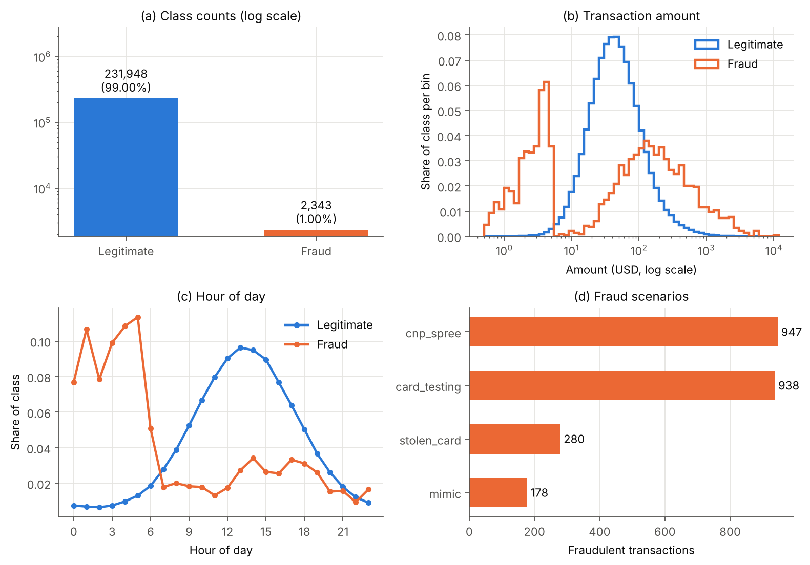
*Figure 1. (a) Class counts (log scale); (b) amount distribution;
(c) hour-of-day profile; (d) fraudulent rows per scenario.*

### 4.2 Accuracy is uninformative; PR-AUC is not

The trivial `always_legit` classifier reaches **98.75% test accuracy with
zero recall**. Every trained model lies between 96.9% and 99.75%
accuracy, so accuracy compresses all the meaningful differences into the
third decimal place. It also ranks models *wrongly*: logistic regression
with class weights at threshold 0.5 has *lower* accuracy than the trivial
model (97.20%), yet it flags 91.0% of frauds and 94.4% of fraudulent
dollars.

Ranking metrics separate the models clearly (Table 1, Figures 2–3).
Histogram gradient boosting reaches **PR-AUC 0.912 [95% CI 0.890, 0.933]**
without imbalance handling, ahead of random forest (0.907) and logistic
regression (0.850). Chance level is 0.0125. ROC-AUC, by contrast, sits in
a narrow band (0.968–0.983) for all 15 configurations, and it sometimes
orders them differently from PR-AUC. Random forest with under-sampling
has a *higher* ROC-AUC than plain random forest (0.982 vs. 0.976) but a
clearly *lower* PR-AUC (0.891 vs. 0.907), because under-sampling improves
the ranking in the high-FPR region nobody operates in and degrades it at
the top of the list. On the log-FPR plot (Figure 3), plain gradient
boosting catches 91.5% of fraud at FPR ≤ 1%.

*Table 1. Test-period results (587 frauds among 46,859 transactions).
P/R/F1 at the default threshold 0.5 and at τ\*, the F1-optimal threshold
chosen on validation. CIs are percentile-bootstrap 95% intervals. Best
value per column in bold.*

| Model | Strategy | PR-AUC [95% CI] | ROC-AUC | P@0.5 | R@0.5 | F1@0.5 | τ\* | P@τ\* | R@τ\* | F1@τ\* | Brier |
|---|---|---|---|---|---|---|---|---|---|---|---|
| LogReg | none | 0.850 [0.823, 0.877] | 0.978 | 0.959 | 0.641 | 0.768 | 0.291 | 0.903 | 0.714 | 0.797 | 0.0040 |
| LogReg | class weights | 0.845 [0.818, 0.871] | 0.979 | 0.298 | 0.910 | 0.449 | 0.953 | 0.904 | 0.692 | 0.784 | 0.0269 |
| LogReg | random under | 0.844 [0.817, 0.871] | 0.979 | 0.284 | 0.910 | 0.432 | 0.963 | 0.918 | 0.671 | 0.776 | 0.0283 |
| LogReg | random over | 0.844 [0.816, 0.870] | 0.979 | 0.299 | 0.908 | 0.450 | 0.956 | 0.902 | 0.678 | 0.774 | 0.0269 |
| LogReg | SMOTE | 0.838 [0.811, 0.865] | 0.979 | 0.273 | 0.903 | 0.419 | 0.959 | 0.892 | 0.692 | 0.779 | 0.0297 |
| RF | none | 0.907 [0.885, 0.928] | 0.976 | 0.981 | 0.782 | 0.870 | 0.452 | 0.977 | 0.804 | 0.882 | 0.0025 |
| RF | class weights | 0.906 [0.884, 0.928] | 0.976 | 0.973 | 0.813 | 0.886 | 0.483 | 0.970 | 0.821 | **0.889** | 0.0026 |
| RF | random under | 0.891 [0.869, 0.914] | 0.982 | 0.304 | **0.925** | 0.457 | 0.895 | 0.907 | 0.797 | 0.849 | 0.0308 |
| RF | random over | 0.904 [0.882, 0.927] | 0.968 | 0.987 | 0.772 | 0.866 | 0.384 | 0.972 | 0.814 | 0.886 | 0.0027 |
| RF | SMOTE | 0.905 [0.885, 0.928] | 0.981 | 0.948 | 0.814 | 0.876 | 0.562 | 0.969 | 0.787 | 0.868 | 0.0030 |
| HGB | none | **0.912** [0.890, 0.933] | 0.982 | **0.993** | 0.779 | 0.873 | 0.149 | 0.960 | **0.828** | **0.889** | 0.0025 |
| HGB | class weights | **0.912** [0.892, 0.933] | 0.978 | 0.940 | 0.857 | **0.897** | 0.872 | **0.985** | 0.801 | 0.883 | **0.0022** |
| HGB | random under | 0.897 [0.875, 0.920] | 0.981 | 0.364 | 0.917 | 0.521 | 0.996 | 0.941 | 0.794 | 0.861 | 0.0169 |
| HGB | random over | 0.909 [0.888, 0.931] | 0.979 | 0.955 | 0.838 | 0.893 | 0.754 | 0.975 | 0.811 | 0.886 | **0.0022** |
| HGB | SMOTE | 0.909 [0.889, 0.930] | **0.983** | 0.953 | 0.826 | 0.885 | 0.569 | 0.960 | 0.819 | 0.884 | 0.0023 |

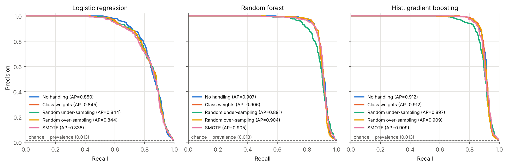
*Figure 2. Precision–recall curves on the test period. The dashed line is
the chance level (prevalence = 0.0125).*

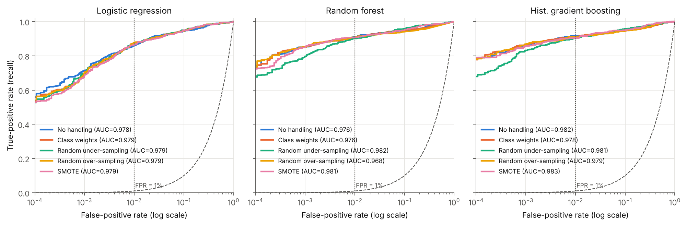
*Figure 3. ROC curves with a log-scaled FPR axis. The dotted line marks
FPR = 1%, where about 460 false alarms would accompany 587 frauds.*

### 4.3 Imbalance handling does not improve ranking quality

Table 2 shows the paired-bootstrap difference in PR-AUC between each
strategy and the same model trained on the raw distribution. **No strategy
improves PR-AUC significantly for any model.** The single positive point
estimate, gradient boosting with class weights at +0.0004, has a CI of
[−0.0046, +0.0054]. Several strategies make it significantly *worse*.
Random under-sampling costs 0.014–0.016 PR-AUC for both tree ensembles,
since it discards 99% of the legitimate training rows. Every strategy
hurts logistic regression, SMOTE the most (−0.0125). Class weights and
random over-sampling are statistically neutral for the tree ensembles.

*Table 2. ΔPR-AUC = PR-AUC(strategy) − PR-AUC(no handling), same model,
paired bootstrap (1,000 resamples). Bold: the CI excludes 0.*

| Strategy | Logistic regression | Random forest | Hist. gradient boosting |
|---|---|---|---|
| class weights | **−0.0057** [−0.0110, −0.0007] | −0.0011 [−0.0053, +0.0028] | +0.0004 [−0.0046, +0.0054] |
| random under | **−0.0062** [−0.0122, −0.0003] | **−0.0164** [−0.0236, −0.0097] | **−0.0143** [−0.0220, −0.0071] |
| random over | **−0.0068** [−0.0123, −0.0015] | −0.0031 [−0.0079, +0.0009] | −0.0030 [−0.0091, +0.0027] |
| SMOTE | **−0.0125** [−0.0194, −0.0059] | −0.0017 [−0.0086, +0.0045] | −0.0028 [−0.0086, +0.0025] |

### 4.4 Robustness across independently generated datasets

The bootstrap in Table 2 measures test-set noise for *one* synthetic
world. We repeated the full grid on five more datasets (seeds 1–5). Each
seed regenerates the customers and the fraud events and re-seeds the
models and the resampling. Table 3 reports the mean and standard
deviation over all six datasets, and Figure 4 shows each dataset as a
dot. Absolute performance varies between worlds: gradient boosting
without handling ranges from 0.845 to 0.912 PR-AUC, and seed 42 is the
easiest of the six. The *paired* differences, however, are stable.

* **Random under-sampling lowers PR-AUC on 6 of 6 datasets for every
  model** (mean −0.019 to −0.023), and F1@τ\* by 0.028–0.044. The same
  holds for **every correction applied to logistic regression** (6/6
  losses; SMOTE is worst at −0.028 PR-AUC). Six losses out of six has
  two-sided sign-test p = 0.031.
* For the tree ensembles, **class weights and ROS are neutral**. Mean
  ΔPR-AUC lies between +0.0001 and +0.0016, the standard deviations are
  larger than the means, and roughly half the datasets go each way. The
  largest consistent gain in the study is gradient boosting with ROS on
  F1@τ\*: +0.004 ± 0.007, positive on 5 of 6 datasets. It is too small to
  matter operationally.
* **SMOTE is never better than no handling on average** (ΔPR-AUC −0.0026
  for RF and −0.0045 for HGB).
* At the 0.5 threshold, the corrections change F1 by −0.32 to −0.50 for
  logistic regression and under-sampling, and by +0.001 to +0.042 for
  class-weighted or over-sampled gradient boosting. The threshold, not the
  ranking, drives these large swings.

*Table 3. Mean ± s.d. over six independent synthetic datasets (seeds 42
and 1–5). Δ is paired within dataset against the same model without
handling. "Wins" counts datasets with Δ > 0.*

| Model | Strategy | PR-AUC | ΔPR-AUC | wins | F1@0.5 | F1@τ\* | ΔF1@τ\* | wins |
|---|---|---|---|---|---|---|---|---|
| LogReg | none | 0.807 ± 0.030 | — | — | 0.745 ± 0.026 | 0.774 ± 0.021 | — | — |
| LogReg | class weights | 0.791 ± 0.036 | −0.0165 ± 0.0066 | 0/6 | 0.355 ± 0.056 | 0.750 ± 0.031 | −0.0235 ± 0.0142 | 0/6 |
| LogReg | random under | 0.788 ± 0.035 | −0.0192 ± 0.0073 | 0/6 | 0.331 ± 0.057 | 0.746 ± 0.029 | −0.0284 ± 0.0128 | 0/6 |
| LogReg | random over | 0.790 ± 0.036 | −0.0170 ± 0.0069 | 0/6 | 0.355 ± 0.055 | 0.747 ± 0.028 | −0.0266 ± 0.0119 | 0/6 |
| LogReg | SMOTE | 0.780 ± 0.038 | −0.0277 ± 0.0094 | 0/6 | 0.336 ± 0.053 | 0.731 ± 0.036 | −0.0434 ± 0.0175 | 0/6 |
| RF | none | 0.875 ± 0.027 | — | — | 0.848 ± 0.015 | 0.857 ± 0.017 | — | — |
| RF | class weights | 0.875 ± 0.027 | +0.0001 ± 0.0025 | 2/6 | 0.851 ± 0.025 | 0.850 ± 0.026 | −0.0074 ± 0.0101 | 2/6 |
| RF | random under | 0.852 ± 0.027 | −0.0227 ± 0.0070 | 0/6 | 0.379 ± 0.046 | 0.814 ± 0.025 | −0.0436 ± 0.0146 | 0/6 |
| RF | random over | 0.876 ± 0.026 | +0.0007 ± 0.0029 | 4/6 | 0.840 ± 0.020 | 0.855 ± 0.020 | −0.0021 ± 0.0066 | 2/6 |
| RF | SMOTE | 0.872 ± 0.030 | −0.0026 ± 0.0051 | 2/6 | 0.845 ± 0.030 | 0.840 ± 0.031 | −0.0170 ± 0.0202 | 1/6 |
| HGB | none | 0.881 ± 0.026 | — | — | 0.852 ± 0.017 | 0.866 ± 0.019 | — | — |
| HGB | class weights | **0.883** ± 0.026 | +0.0016 ± 0.0041 | 4/6 | 0.869 ± 0.021 | 0.869 ± 0.014 | +0.0024 ± 0.0061 | 4/6 |
| HGB | random under | 0.859 ± 0.028 | −0.0219 ± 0.0080 | 0/6 | 0.457 ± 0.053 | 0.827 ± 0.034 | −0.0391 ± 0.0286 | 0/6 |
| HGB | random over | 0.881 ± 0.026 | +0.0002 ± 0.0052 | 2/6 | **0.870** ± 0.020 | **0.870** ± 0.017 | +0.0041 ± 0.0066 | 5/6 |
| HGB | SMOTE | 0.877 ± 0.028 | −0.0045 ± 0.0083 | 2/6 | 0.864 ± 0.018 | 0.864 ± 0.019 | −0.0022 ± 0.0026 | 2/6 |

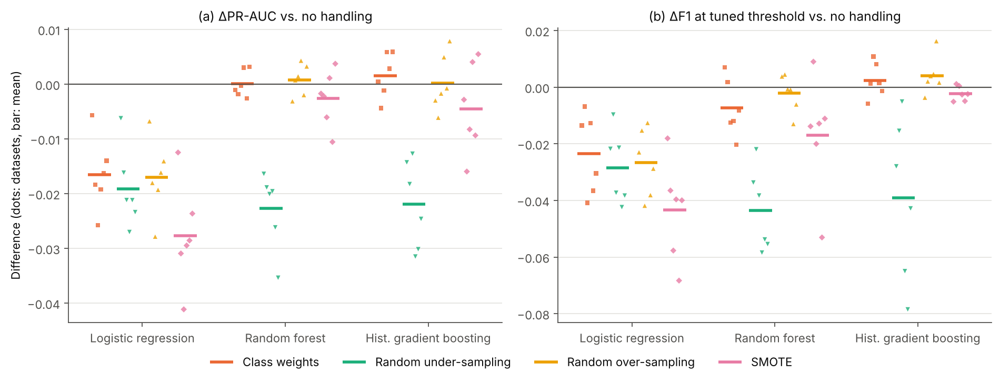
*Figure 4. Paired differences against no handling across six
independently generated datasets. Dots are datasets and bars are means.
(a) ΔPR-AUC; (b) ΔF1 at the tuned threshold.*

### 4.5 What imbalance handling really changes: the operating point

At the default threshold of 0.5 the strategies look very different
(Figure 5b, Figure 6). For logistic regression every correction raises
recall from 0.641 to about 0.91 and drops precision from 0.959 to
0.27–0.30. Alerts rise from 392 to 1,783–1,942 and F1 falls from 0.768 to
0.42–0.45. For the tree ensembles, class weights, over-sampling and SMOTE
*raise* F1@0.5: gradient boosting goes from 0.873 to 0.897 with class
weights, 0.893 with ROS and 0.885 with SMOTE, and random forest goes from
0.870 to 0.886 with class weights. The reason is that the unweighted trees
are *too conservative* at 0.5. Their validation-optimal threshold is far
lower (τ\* = 0.149 for gradient boosting). Under-sampling overshoots for
every model (precision 0.28–0.36 at 0.5).

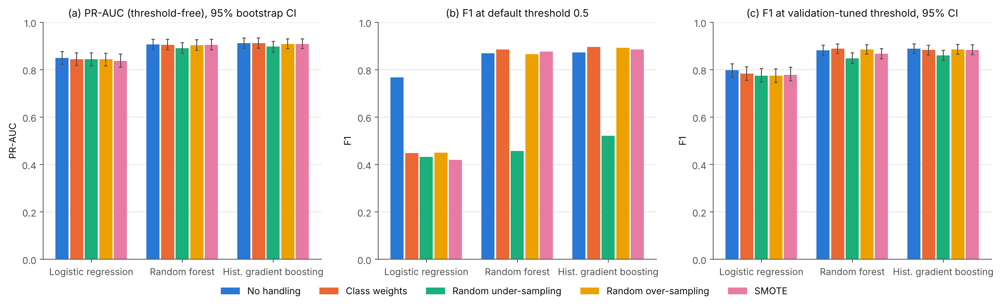
*Figure 5. Effect of each strategy. (a) PR-AUC with 95% CI; (b) F1 at
threshold 0.5; (c) F1 at the validation-tuned threshold τ\*, with 95% CI.*

Once the threshold is tuned on validation, most of the spread disappears
(Figure 5c). The tuned thresholds of the corrected logistic models are
0.953–0.963: the threshold simply *undoes* the prior shift that weighting
or resampling introduced [5, 8]. With tuned thresholds, the best F1 for
each model comes from **no handling** (logistic regression, 0.797;
gradient boosting, 0.889) or from **class weights** (random forest,
0.889). These are statistically tied with ROS and SMOTE. Under-sampling
stays worst for the tree ensembles (0.849, 0.861). Figure 6 shows each
configuration's move from its 0.5 operating point to its tuned one: the
configurations start far apart and end close together.

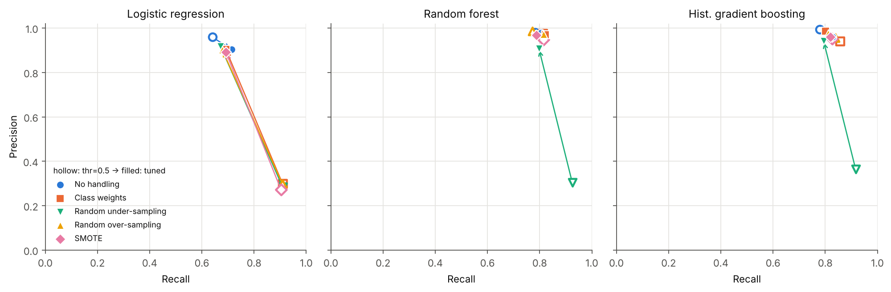
*Figure 6. Precision and recall at threshold 0.5 (hollow) and at τ\*
(filled). Tuning moves every configuration towards the same frontier.*

Tuning on a short validation period has a cost. It contains only 427
frauds, so τ\* is noisy. For class-weighted gradient boosting, τ\* = 0.872
gives a *lower* test F1 (0.883) than the untuned 0.5 (0.897). The error
from threshold selection is about as large as the differences between
strategies.

The confusion matrices of the best model family (Figure 7) make the
trade-off concrete. Plain gradient boosting at τ\* catches 486 of 587
frauds with 20 false alarms among 46,272 legitimate transactions
(precision 0.960, recall 0.828, MCC 0.891). Under-sampling at 0.5 catches
538 frauds, but with 940 false alarms.

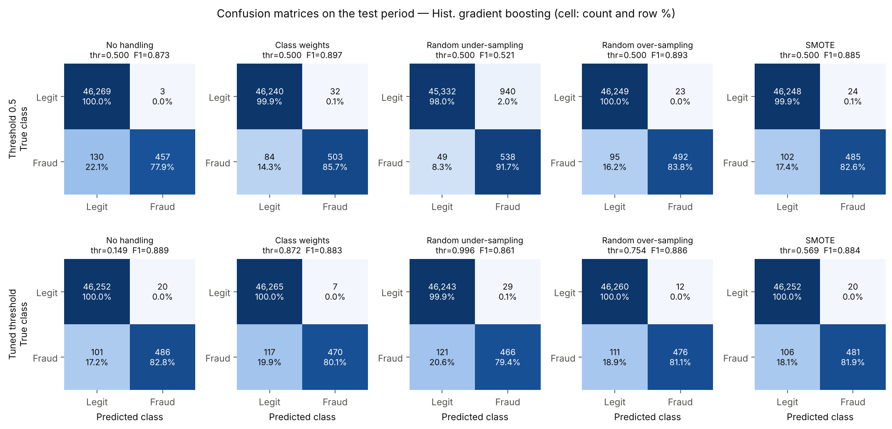
*Figure 7. Test confusion matrices of histogram gradient boosting for each
strategy at threshold 0.5 (top) and τ\* (bottom). Cells show count and
row-normalised percentage.*

### 4.6 Effect of the resampling ratio

Balancing to 1:1 is the most aggressive choice. Figure 8 varies the
post-resampling minority:majority ratio *r* ∈ {0.02, 0.05, 0.1, 0.25, 0.5,
1}. The natural training ratio is about 0.0096. Three patterns appear:

1. **PR-AUC peaks at mild ratios and falls toward 1:1.** For logistic
   regression the decline is monotone: SMOTE goes from 0.849 at r = 0.02
   to 0.838 at r = 1, and RUS from 0.851 to 0.844. For gradient boosting,
   ROS at r = 0.1 reaches **0.917**, the highest PR-AUC in the study, and
   SMOTE at r = 0.02 reaches 0.914. Both fall to 0.909 at r = 1. RUS falls
   from 0.911 at r = 0.05 to 0.897 at r = 1. The gains of mild
   over-sampling over no handling (+0.002 to +0.005) are no larger than the
   paired-CI half-widths in Table 2 (about ±0.005), so they are suggestive
   at best.
2. **Under-sampling degrades steadily with *r*.** Each step discards more
   legitimate behaviour. At r = 1 only 2,658 training rows remain.
3. **The 0.5-threshold precision collapses as *r* grows.** For logistic
   regression it falls from 0.92 to 0.27–0.30, and for gradient boosting
   with RUS from 0.98 to 0.36. Recall rises at the same time. Again, the
   ratio mostly sets where the default threshold lands.

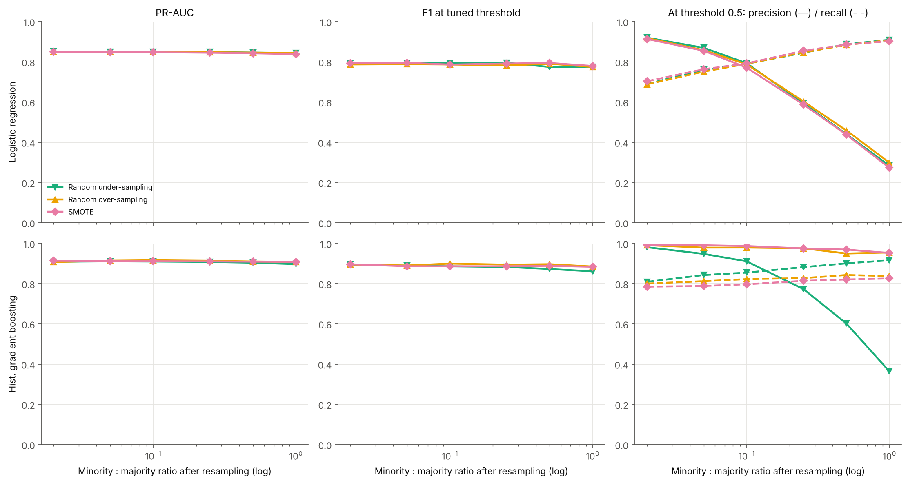
*Figure 8. Test PR-AUC (left), F1 at τ\* (middle) and precision (solid) /
recall (dashed) at threshold 0.5 (right) against the resampling ratio, for
logistic regression (top) and gradient boosting (bottom).*

### 4.7 Calibration

Reweighting and resampling change what the scores *mean* (Figure 9,
Brier column of Table 1). For logistic regression the Brier score rises
roughly 7×, from 0.0040 to 0.0269–0.0297, because predicted probabilities
are inflated towards the artificial 50% prior. Under-sampling is the worst
case for every model (RF 0.0308, HGB 0.0169), over-predicting fraud by
about an order of magnitude. The unweighted gradient-boosting model is
*under*-confident in the 10⁻³–10⁻¹ score range: observed fraud frequency
there exceeds the prediction. Two effects plausibly contribute. Shrinkage
and L2 regularisation pull rare-class leaf values toward the base rate,
and test prevalence is higher than training prevalence (1.25% vs. 0.95%).
Class weights, ROS and SMOTE happen to cancel this, so the gradient
boosting Brier score improves slightly (0.0025 → 0.0022). Imbalance
handling is therefore not "always miscalibrating". If calibrated
probabilities are needed, for example for expected-loss decisions, the
model should be recalibrated after training whatever strategy was used
[9].

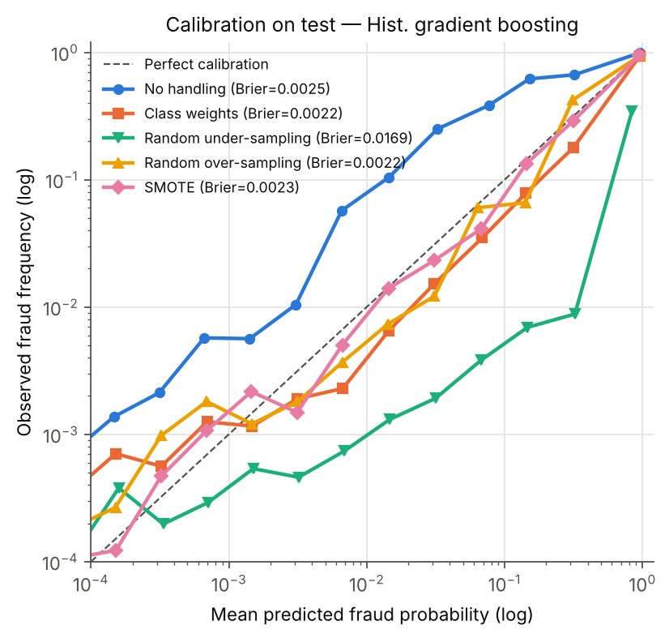
*Figure 9. Reliability diagram (log-spaced bins with ≥ 20 transactions)
for gradient boosting.*

### 4.8 Which frauds are caught, and by which features

Recall varies far more across fraud *scenarios* than across imbalance
strategies (Figure 10, `results/recall_by_scenario.csv`). With tuned
thresholds the tree ensembles catch 97–99.6% of `card_testing` rows (250 in
test), 72–80% of `cnp_spree` (243) and 51–64% of `stolen_card` (66).
Essentially no `mimic` fraud is caught (28 rows; one configuration catches
1 of 28). No imbalance strategy changes this pattern. Fraud that looks
exactly like the customer's own behaviour cannot be recovered by
re-weighting the classes, only by new information.

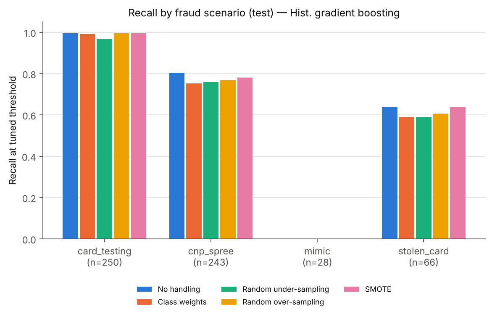
*Figure 10. Recall per fraud scenario for gradient boosting (tuned
thresholds).*

Permutation importance of the best model (gradient boosting with class
weights, Figure 11) is led by log geolocation distance (ΔPR-AUC 0.139 when
shuffled), then hour of day (0.056), the online flag (0.035), the
*behavioural* amount deviation log(amount / typical) (0.031), hours since
the last transaction (0.023), and 1-hour spend velocity (0.013). Several
behavioural features are correlated with each other, for example the 1-h
count and the 1-h sum, or the z-score and the ratio. Permutation
importance therefore understates their joint contribution.

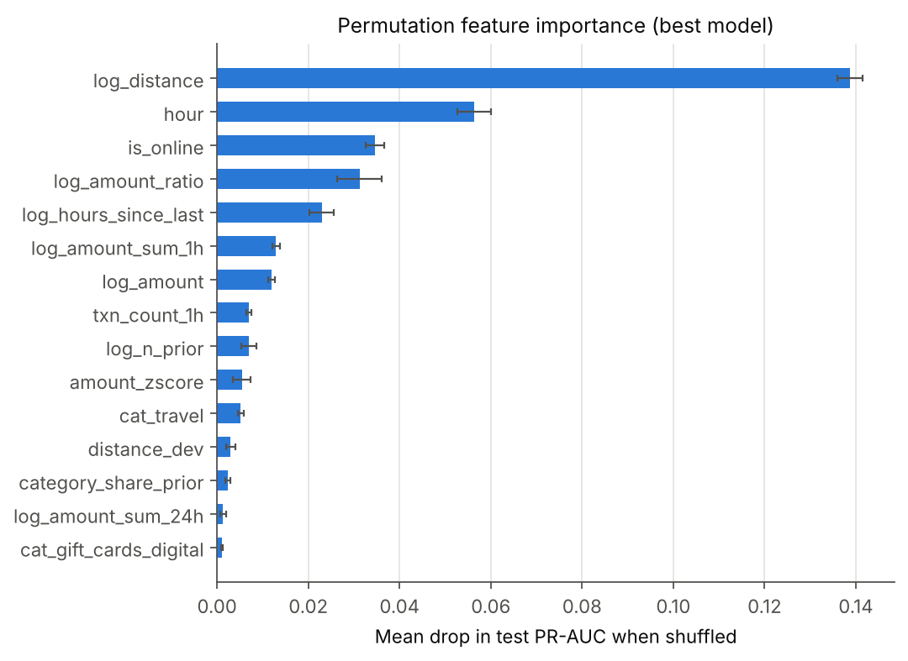
*Figure 11. Permutation importance (mean drop in test PR-AUC over 5
shuffles; error bars are the standard deviation).*

## 5 Discussion and Limitations

### 5.1 Interpretation

The results support a simple practical message. **Class imbalance is
mainly a thresholding and evaluation problem, not a learning problem, at
least for flexible models with enough minority examples.** With 1,329
fraudulent training rows, unweighted gradient boosting and random forests
already learn a near-optimal *ranking*. Class weights, over-sampling and
SMOTE change the score scale, and therefore where 0.5 falls, but not the
order of transactions. Under-sampling also throws away information about
legitimate behaviour, which a fraud model depends on, and it loses ranking
quality in a statistically significant way. This matches Elkan's analysis
of priors and thresholds [5] and recent evidence that imbalance
corrections mostly harm calibration without improving discrimination [8].
SMOTE was the least helpful option for the linear model. Interpolating
standardised one-hot and count features creates points off the data
manifold, such as fractional categories, which a linear decision boundary
then has to accommodate [7, 19].

Imbalance handling is still useful when it is treated as a *threshold
device*. Teams that ship a model with a 0.5 cut-off, or that need recall
≥ 0.9 without building a tuning step, get that behaviour "for free" from
class weights. Mild over-sampling (r ≈ 0.05–0.1) was also the only
setting with a positive, though non-significant, PR-AUC effect. A robust
recipe is therefore: (1) train on the natural distribution, or with class
weights for tree ensembles; (2) select models by PR-AUC with CIs;
(3) choose the operating threshold on a later, held-out period according
to the alert budget or the cost ratio; (4) recalibrate if probabilities
feed downstream decisions.

### 5.2 Limitations

* **Synthetic data.** The generator encodes our assumptions about fraud
  behaviour. Real fraud has adaptive adversaries, merchant-level
  compromise, device and network signals, and concept drift [1]. The
  absolute numbers (PR-AUC ≈ 0.91) reflect how separable we made the
  scenarios. They are not a forecast for production. The *relative*
  conclusions are what we expect to transfer, and §4.4 shows they hold
  across independently generated datasets.
* **One prevalence level.** We studied π = 1%. At much lower prevalence
  (0.1% or less), or with far fewer minority training examples, the
  balance may tip toward resampling or weighting [9, 14].
* **Fixed hyper-parameters.** We deliberately did not tune per strategy.
  Tuning, for example tree depth under class weighting, might recover
  small differences. We do not expect it to reverse the main effect.
* **Clean, immediate labels.** Real labels arrive with weeks of delay
  through chargebacks and are partly noisy. We also did not model
  verification latency or feedback loops [1].
* **SMOTE variants.** Only plain SMOTE was evaluated. SMOTE-NC, which is
  aware of categorical features, and borderline or ADASYN variants [19]
  might handle the one-hot features better.
* **Threshold tuning on one validation period.** With 427 validation
  frauds, τ\* is noisy (§4.5). A rolling or cross-temporal selection
  scheme would be more stable.

### 5.3 A note on leakage

During development, the causality unit test caught a subtle leak. The
cold-start fallback for the amount z-score used the mean and standard
deviation of *all* transactions, including future ones. The effect on
the metrics was small, but this kind of leakage is common in fraud
pipelines and usually goes unnoticed. We recommend encoding the
"only-the-past" contract as a test rather than relying on code review.

## 6 Conclusion

We built a reproducible fraud-detection study on a documented synthetic
transaction stream with 1% fraud. It uses causal behavioural features, a
chronological evaluation and 15 model × imbalance-strategy combinations.
Histogram gradient boosting reached PR-AUC 0.912 [0.890, 0.933] and, at a
validation-tuned threshold, precision 0.960 and recall 0.828 (F1 0.889).
Accuracy was useless for model selection: the trivial classifier scored
98.75%. Explicit imbalance handling never significantly improved PR-AUC.
Under-sampling, and every correction applied to logistic regression,
significantly reduced it, and most strategies harmed calibration. The
large F1 differences at the default threshold, up to 0.45 F1 points
between configurations of the same model, almost vanish once the threshold is
tuned. Class weights and resampling are therefore best understood as
threshold-shifting tools. The levers that mattered more were the
classifier family, the behavioural features (distance, timing, amount
deviation and velocity), and a principled choice of operating point. The
fraud that remains undetected (`mimic`) calls for new signals, not
re-weighting.

## References

[1] A. Dal Pozzolo, G. Boracchi, O. Caelen, C. Alippi, G. Bontempi. "Credit card fraud detection: a realistic modeling and a novel learning strategy." *IEEE Transactions on Neural Networks and Learning Systems*, 29(8):3784–3797, 2018.

[2] R. J. Bolton, D. J. Hand. "Statistical fraud detection: A review." *Statistical Science*, 17(3):235–255, 2002.

[3] T. Saito, M. Rehmsmeier. "The precision-recall plot is more informative than the ROC plot when evaluating binary classifiers on imbalanced datasets." *PLoS ONE*, 10(3):e0118432, 2015.

[4] J. Davis, M. Goadrich. "The relationship between precision-recall and ROC curves." *Proc. 23rd International Conference on Machine Learning (ICML)*, 233–240, 2006.

[5] C. Elkan. "The foundations of cost-sensitive learning." *Proc. 17th International Joint Conference on Artificial Intelligence (IJCAI)*, 973–978, 2001.

[6] N. V. Chawla, K. W. Bowyer, L. O. Hall, W. P. Kegelmeyer. "SMOTE: Synthetic minority over-sampling technique." *Journal of Artificial Intelligence Research*, 16:321–357, 2002.

[7] G. Lemaître, F. Nogueira, C. K. Aridas. "Imbalanced-learn: A Python toolbox to tackle the curse of imbalanced datasets in machine learning." *Journal of Machine Learning Research*, 18(17):1–5, 2017.

[8] R. van den Goorbergh, M. van Smeden, D. Timmerman, B. Van Calster. "The harm of class imbalance corrections for risk prediction models: illustration and simulation using logistic regression." *Journal of the American Medical Informatics Association*, 29(9):1525–1534, 2022.

[9] A. Dal Pozzolo, O. Caelen, R. A. Johnson, G. Bontempi. "Calibrating probability with undersampling for unbalanced classification." *IEEE Symposium Series on Computational Intelligence (SSCI)*, 159–166, 2015.

[10] A. Dal Pozzolo, O. Caelen, Y.-A. Le Borgne, S. Waterschoot, G. Bontempi. "Learned lessons in credit card fraud detection from a practitioner perspective." *Expert Systems with Applications*, 41(10):4915–4928, 2014.

[11] A. Correa Bahnsen, D. Aouada, A. Stojanovic, B. Ottersten. "Feature engineering strategies for credit card fraud detection." *Expert Systems with Applications*, 51:134–142, 2016.

[12] F. Pedregosa et al. "Scikit-learn: Machine learning in Python." *Journal of Machine Learning Research*, 12:2825–2830, 2011.

[13] D. Chicco, G. Jurman. "The advantages of the Matthews correlation coefficient (MCC) over F1 score and accuracy in binary classification evaluation." *BMC Genomics*, 21:6, 2020.

[14] H. He, E. A. Garcia. "Learning from imbalanced data." *IEEE Transactions on Knowledge and Data Engineering*, 21(9):1263–1284, 2009.

[15] L. Breiman. "Random forests." *Machine Learning*, 45(1):5–32, 2001.

[16] G. Ke, Q. Meng, T. Finley, T. Wang, W. Chen, W. Ma, Q. Ye, T.-Y. Liu. "LightGBM: A highly efficient gradient boosting decision tree." *Advances in Neural Information Processing Systems 30*, 3146–3154, 2017.

[17] B. Efron, R. J. Tibshirani. *An Introduction to the Bootstrap*. Chapman & Hall/CRC, 1993.

[18] E. A. Lopez-Rojas, A. Elmir, S. Axelsson. "PaySim: A financial mobile money simulator for fraud detection." *Proc. 28th European Modeling and Simulation Symposium (EMSS)*, 249–255, 2016.

[19] A. Fernández, S. García, F. Herrera, N. V. Chawla. "SMOTE for learning from imbalanced data: Progress and challenges, marking the 15-year anniversary." *Journal of Artificial Intelligence Research*, 61:863–905, 2018.
